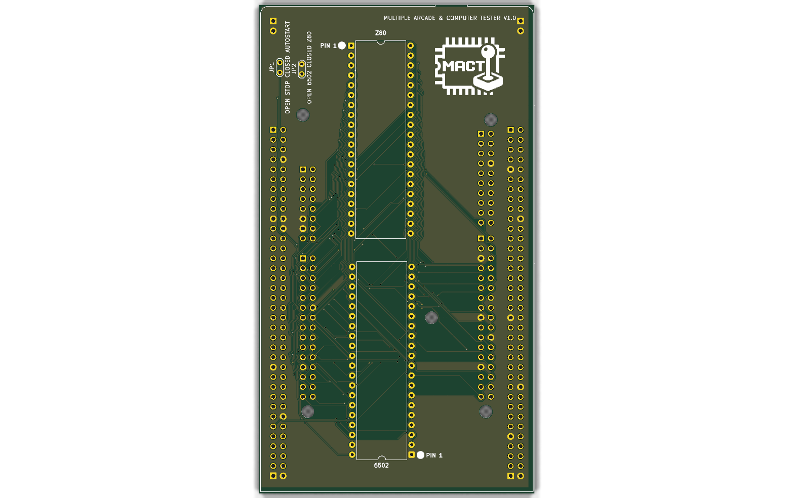
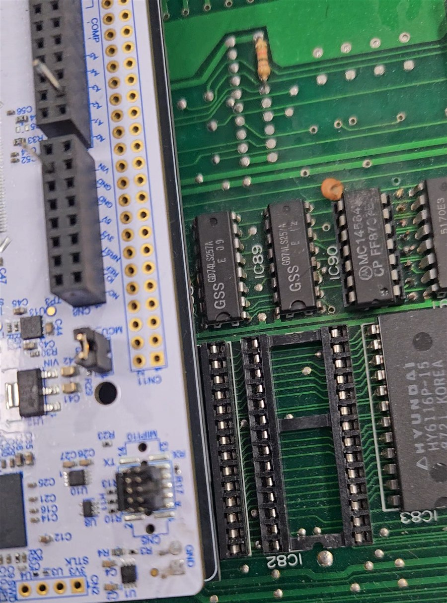

# MACT - Multiple Arcade & Computer Tester

*[Leggi in italiano](README.it.md)*

MACT replaces the CPU of a **real arcade board** with an STM32H723 microcontroller
(NUCLEO-H723ZG). A 6502 or Z80 core runs in software, but every memory and I/O
access is a **real bus cycle** on the CPU socket, timed from the board's own
clock. The board's ROM, RAM, video and sound hardware see a working CPU, while
you get a debug monitor, a network ROM loader and memory tools from the outside.

## What you can do with it

- **Run a board without its CPU**: Z80 and 6502 (selected by a jumper).
- **Serve the ROMs from the MCU**: load game ROMs over the network into
  internal memory and pull the EPROMs from the board. Bank-switched ROM areas
  are supported (configurable "bank windows").
- **Debug the board live**: memory display/modify, disassembler, single step,
  registers, I/O log, CRC of ROM areas, RAM test, bus stability tests.
- **Watch memory while the game runs** from the PC app, with a terminal on the
  same window.
- **Run your own code** on the board: see the [demos](demos/).

Tested so far: an Arkanoid board (Z80) runs at 99.9% of the real clock
with all ROMs served by the MCU, and an Atari Sprint 2 board (6502) runs at
99.7% of the real clock, both with the game and with the demo.

## Repository contents

| Folder | Content |
|---|---|
| [`firmware/`](firmware/) | ready-to-flash firmware (`.hex`) for the NUCLEO-H723ZG |
| [`hardware/`](hardware/) | adapter PCB rev 1.0: schematic and PCB PDF, gerbers, BOM, renders, required hand modifications |
| [`app/`](app/) | **MACT Studio**, the PC application (Windows / macOS): source code; installers in the [Releases](https://github.com/alexbrsc66/MACT/releases) |
| [`docs/`](docs/) | [MACT Studio quick guide](docs/mact-studio.md), [firmware user guide](docs/firmware.md), [network protocol](docs/protocol.md) |
| [`demos/`](demos/) | demo programs for the Arkanoid and Sprint 2 boards |
| [`LICENSES/`](LICENSES/) | third-party licenses of the code inside the firmware |
| [`tools/`](tools/) | [board simulator](tools/mact_board_sim.py): try MACT Studio without a board |

The firmware source code is not published in this first release.

## Quick start

1. Build or order the [adapter](hardware/) and apply the hand modifications to
   the adapter and to the Nucleo (see the [hardware notes](hardware/README.md)).
2. Flash [`firmware/MACT-firmware-1.0.0.hex`](firmware/): connect the Nucleo
   ST-Link USB port and copy the file onto the `NOD_H723ZG` drive.
3. Set JP2 for the CPU (open = 6502, closed = Z80), remove the CPU from the
   board, plug the adapter into the CPU socket, power the board.
4. Open the ST-Link virtual COM port at **115200 8N1** and type `?` for help,
   `go` to start. The same console is on TCP port 3335.

Full details in the [firmware user guide](docs/firmware.md).

No board at hand? Run the simulator on any computer with Python 3
(`python3 tools/mact_board_sim.py`): it answers MACT Studio like the firmware
(ROM upload, bank windows, memory watch, console) and prints the address to
connect to.

## Electrical compatibility

The STM32 runs at **3.3 V**. Its bus pins are 5 V tolerant, so it reads the
5 V signals of the board without problems, but the signals it drives (address,
data when writing, control lines) only reach about 3.3 V.

- **Works:** TTL logic (74LS, 74S, 74F), 74HCT / 74ACT, NMOS chips and most
  EPROM / RAM chips, which see a high level from about 2 V. All the boards
  tested so far use this kind of logic.
- **Not guaranteed:** 5 V CMOS logic with CMOS input levels (74HC, 74AC, 4000
  series), which needs about 3.5 V for a high level: 3.3 V is at the limit or
  below, so the board may misread the CPU signals. Such a board would need
  level shifters (for example 74HCT245 / 74HCT541) between the adapter and the
  socket; the rev 1.0 adapter does not have them.
- The 5 V tolerance holds only while the Nucleo is powered: power it together
  with the board, never feed 5 V signals to an unpowered Nucleo.

## License

MACT is licensed under the [PolyForm Noncommercial License 1.0.0](LICENSE):
free for personal, hobby, research and educational use; commercial use is
not allowed without permission. Third-party components keep their own
licenses, listed in [`LICENSES/`](LICENSES/).

**Game ROMs are not included and must not be redistributed.** Use only ROMs
you are entitled to use.
