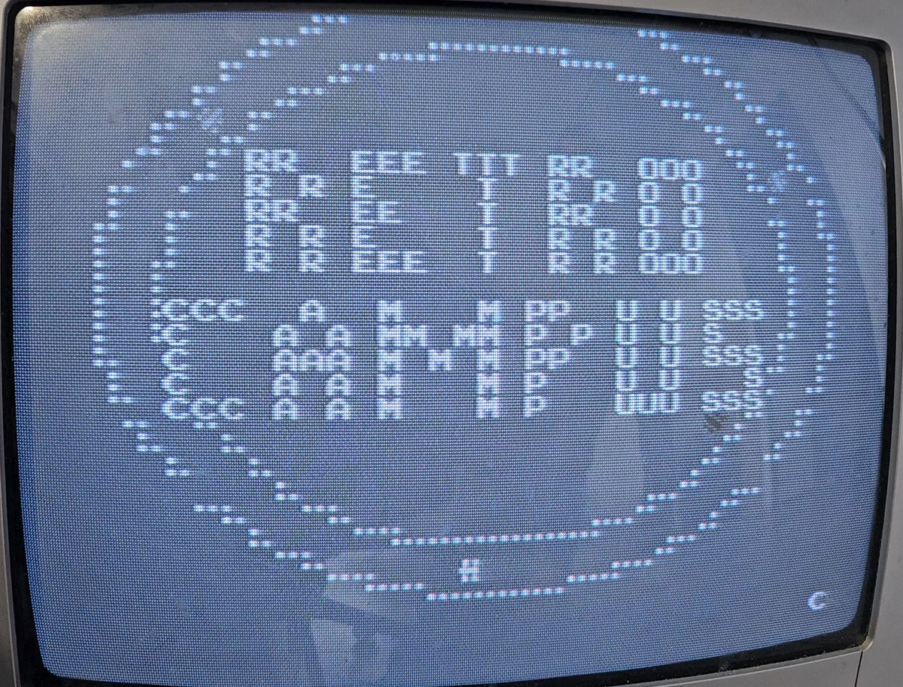

# Demos

Small programs written from scratch for the MACT test boards. They replace the
game program ROM only: the board's own graphics ROMs (character set, sprites,
playfield tiles) stay on the board, so **you need the original board and its
graphics ROMs**. No game code or graphics is included here.

Load a demo with the PC app (open the `demo.json` configuration, the
`demo.bin` image must be in the same folder) or with the network protocol in
[`docs/protocol.md`](../docs/protocol.md).

| Folder | Board | CPU | What it shows |
|---|---|---|---|
| `arkanoid/` | Arkanoid hardware | Z80 | big rainbow "RETRO CAMPUS" logo, rows of bricks, bouncing ball, text scroller, music on the YM2149 |
| `sprint2/` | Atari Sprint 2 | 6502 | oval track with "RETRO / CAMPUS" letters, a black car slaloms between the letters while three cars lap the oval, text scroller |

Each folder contains:

| File | Content |
|---|---|
| `demo.bin` | ROM image to load |
| `demo.json` | memory map for the PC app (where the image goes) |

*The Sprint 2 demo on an original Atari Sprint 2 board (photo of the monitor).*

Memory maps:

- **Arkanoid**: `demo.bin` (32 KB) at `0000`; ROM 2 (`8000-BFFF`) is not used.
- **Sprint 2**: `demo.bin` (8 KB) at `2000` and again at `E000` (6502 vectors).

Both demos have been tested on the real boards.
