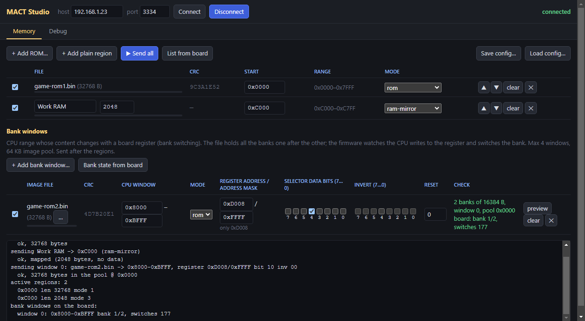
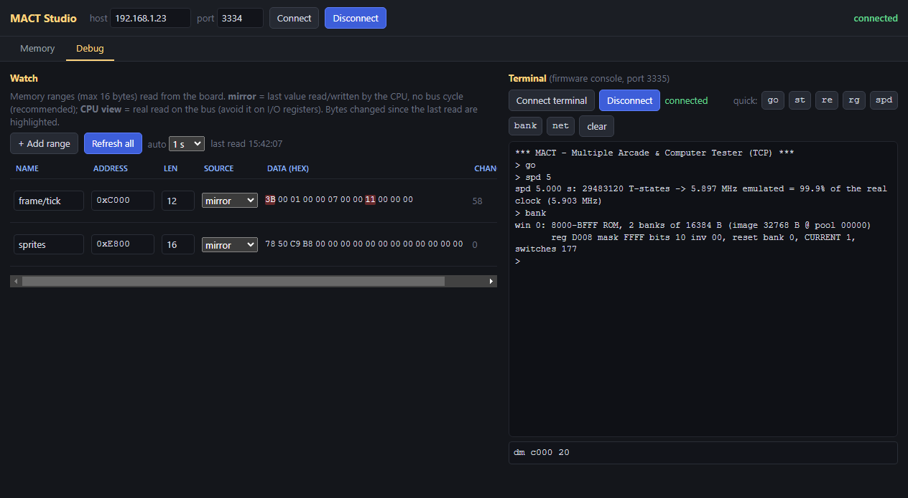

# MACT Studio - quick guide

MACT Studio talks to the MACT firmware over the network: it loads ROM/RAM images
into the board, sets up bank-switched areas, watches memory while the game runs
and gives you the firmware console. Installers: see [`app/`](../app/).

The screenshots show an example setup for an Arkanoid board (Z80):
program ROM at `0000`, work RAM mirrored at `C000`, and the second ROM
bank-switched at `8000-BFFF` by bit 4 of the register at `D008`.

## 1. Connect

1. Power the board with the MACT adapter. The serial console prints the board
   IP at boot (or type `net`).
2. Type the IP in **host** (the port stays `3334`) and click **Connect**. The
   status on the right turns green: *connected*. The app remembers the last IP.

## 2. Memory tab: ROMs, RAM and bank windows

- **+ Add ROM...** - pick a `.bin` file, set the **start** address and the
  **mode**:

  | Mode | Meaning |
  |---|---|
  | `rom` | the CPU reads the image from the MCU; the EPROM can be removed from the board |
  | `ram` | internal RAM, the board RAM is not used |
  | `ram-mirror` | the board RAM is used, and the MCU keeps a copy (used by the watch) |
  | `hw (not mapped)` | the real board hardware (default for every address) |

- **+ Add plain region** - a region without a file (typically RAM): name, size,
  start, mode.
- **Bank windows** - for ROM areas switched by a board register. Give the image
  file (all the banks one after the other), the **start** of the CPU window (the
  end is computed), the **register address** with its **address mask** (`FFFF`
  = that address only) and the **selector data bits**. The **Check** column
  explains what is wrong before you send, and shows the live bank once sent.
  **preview** shows which bank each value written to the register selects.
- **Send all** - sends the regions, then the bank windows. The log at the
  bottom shows each step and the answer of the board.
- **Save config... / Load config...** - the whole setup in a `.json` file
  (the board IP is not saved in it). The [demos](../demos/) come with ready
  `.json` files.

The images live in the MCU RAM: after a reset of the Nucleo, click **Send all**
again.

## 3. Debug tab: watch and terminal

**Watch** (left)
- **+ Add range** - name, address, length (up to 16 bytes).
- **Source**: `mirror` reads the last value seen by the CPU, with no bus cycle:
  safe, recommended. `CPU view` really reads the bus: avoid it on I/O registers.
- **Refresh all**, or **auto** every 0.5-5 s. Bytes changed since the last read
  are highlighted in red; **Changes** counts how many times the range changed.

**Terminal** (right)
- The firmware console on port 3335: the same commands as the serial console
  (`?` for help). It connects by itself at the first command.
- Quick buttons: `go` start, `st` stop, `re` CPU reset, `rg` registers,
  `spd` speed over 5 s, `bank` bank windows, `net` network.
- Up/down arrows recall the previous commands.

## Typical session

1. **Connect**, **Load config...** (e.g. `demos/sprint2/demo.json`), **Send all**.
2. In the terminal: `re`, then `go`.
3. `spd` to check the speed (about 99.7-99.9% of the real clock), watch
   ranges to follow the program.

The full list of firmware commands is in the [firmware guide](firmware.md).
