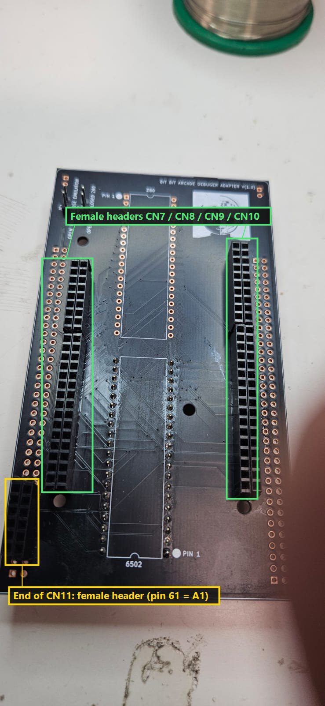
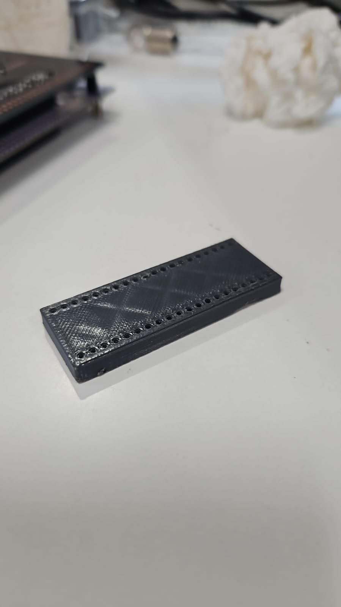
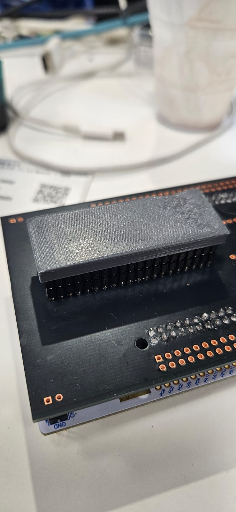
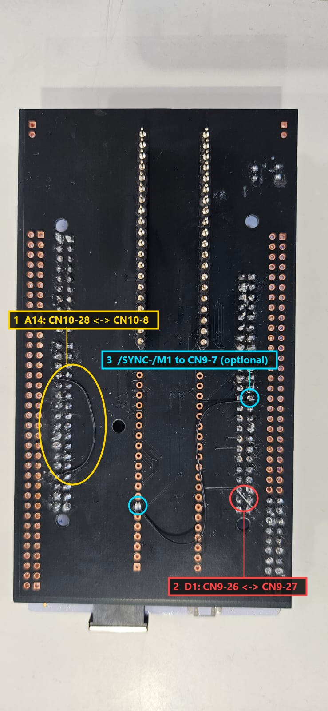
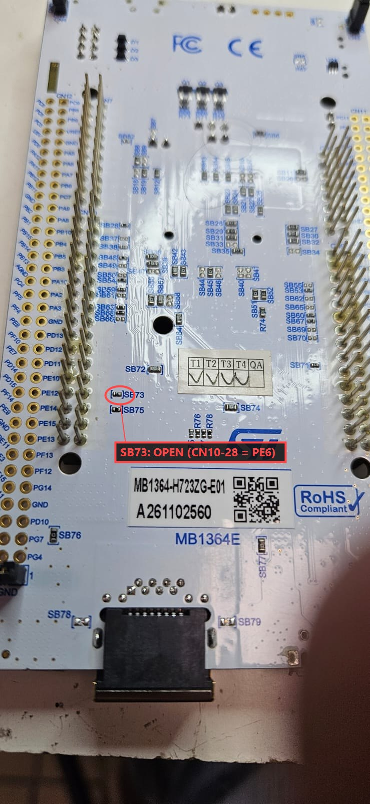
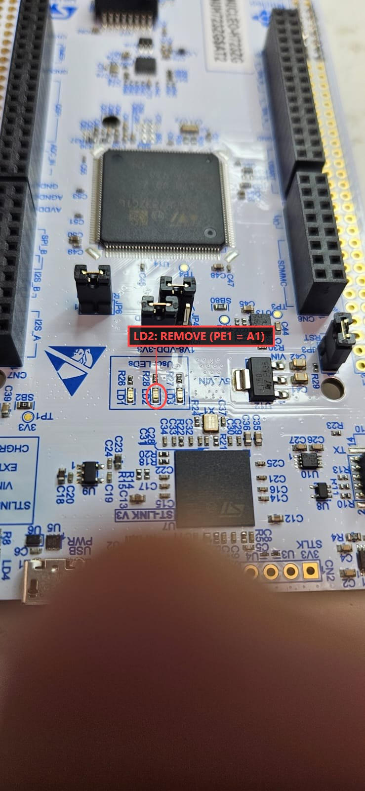
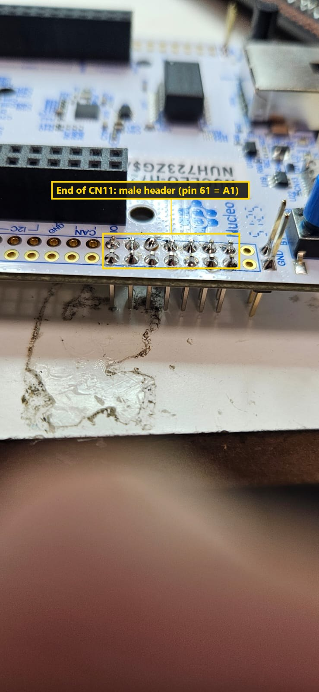

# MACT adapter - rev 1.0

The adapter connects the NUCLEO-H723ZG (ST morpho connectors CN11/CN12 and the
Zio connectors) to the CPU socket of the arcade board. Two 1x20 male pin strips,
soldered on the bottom side with the pins pointing down, plug into the 40-pin
CPU socket. There are two plug positions: **U1 = 6502** and **U2 = Z80** (they
have different pinouts). Populate only the one for your board.

In the schematic U1 and U2 are drawn as the CPU chips, so that the pinout is
correct; on the board they are pin strips.

The renders show the bare PCB. For the assembled adapter see the photos in
`photos/` (they show a board with the earlier logo; the circuit is the same).

| File | Content |
|---|---|
| `MACT-adapter-rev1.0-schematic.pdf` | schematic |
| `MACT-adapter-rev1.0-pcb.pdf` | PCB layers (copper, silkscreen, fab) |
| `3d/dip40-protector.stl` | 3D-printable cap for the pin strips (optional) |
| `MACT-adapter-rev1.0-gerbers.zip` | gerbers + Excellon drill file, ready for a PCB fab (2 layers) |
| `MACT-adapter-rev1.0-bom.csv` | bill of materials |
| `MACT-adapter-rev1.0-top.png` / `-bottom.png` | renders of the bare PCB |

## Bill of materials

| Ref | Part | Notes |
|---|---|---|
| U1 | 2 x male pin strip 1x20, 2.54 mm (rows 15.24 mm apart) | plug for the **6502** socket, bottom side; only for 6502 boards |
| U2 | 2 x male pin strip 1x20, 2.54 mm (rows 15.24 mm apart) | plug for the **Z80** socket, bottom side; only for Z80 boards |
| U3 | NUCLEO-H723ZG (MB1364) | plugs into the female headers below |
| - | female headers, 2.54 mm, for **CN7, CN8, CN9, CN10** | full length, on the adapter |
| - | short 2-row female header for the **end of CN11** | on the adapter, covering pin 61 (A1) |
| - | short 2-row male header for the **end of CN11** | soldered on the **Nucleo**, matching the female one |
| JP1 | 2-pin header + jumper | autostart (see below) |
| JP2 | 2-pin header + jumper | CPU type (see below) |

## Assembly

- Solder **female headers** on the adapter for the Nucleo Zio connectors
  **CN7, CN8, CN9 and CN10**.
- The address line **A1** comes from **CN11 pin 61** (PE1), on the ST morpho
  connector. Solder a short 2-row **female header** on the adapter at the end
  of CN11, covering pin 61, and a matching **male header** on the Nucleo at the
  same position, so that the signal reaches the adapter.
- Solder the two 1x20 male pin strips of the CPU you need (U1 = 6502 or
  U2 = Z80) on the bottom side, pins pointing down.
- Apply the hand modifications and the Nucleo modifications below.

The photos show a rev 1.0 board made before the MACT branding: it has the old
logo and the old JP1 label, but the same circuit.

## Pin protector (optional)

A 3D-printed cap that covers the pin strips sticking out under the adapter, to
protect them (and the bench) when the adapter is not plugged into a board:
[`3d/dip40-protector.stl`](3d/dip40-protector.stl), 53 x 20 x 5 mm, 40 holes
on the DIP-40 pitch (2.54 mm, rows 15.24 mm apart). Any material works (PLA,
PETG).

| Printed cap | On the adapter |
|---|---|
|  |  |

## Jumpers

| Jumper | Nucleo pin | Open | Closed |
|---|---|---|---|
| JP1 | PA3 (CN9-1) | emulation starts stopped, type `go` | emulation starts at power-on (if the board clock is present) |
| JP2 | PF9 (CN9-28) | 6502 | Z80 |

Boards made before this release may have the JP1 silkscreen
"OPEN TRACE CLOSE EMULATION": it is the same jumper, with the same function.

## Required hand modifications (rev 1.0)

Rev 1.0 needs two wires (a third one is optional).

1. **D1 bodge** - the CPU data line D1 is routed to CN9-26 (**PF7**), but the
   firmware reads D1 on **PD1** (CN9-27). Join CN9-26 and CN9-27 with a short
   wire. PF7 is kept as an input by the firmware: never use it for anything else.
2. **A14 bodge** - the address line A14 is routed to CN10-28, but on the
   NUCLEO-H723ZG that pin is **PE6** (= A6, through solder bridge SB73), while
   the firmware drives A14 on **PE14**, which is CN10-8. Open SB73 on the Nucleo
   (see below), then join CN10-28 and CN10-8 with a short wire. On the PCB CN10-8 is also connected to the Z80 /HALT pin (U2 pin 18),
   so A14 reaches that pin too: harmless on the boards tested so far, but to be
   safe cut the track from CN10-8 to U2 pin 18 (/HALT is not used by MACT).
3. **/SYNC (6502) - /M1 (Z80) wire** - optional, only if you want the opcode
   fetch signal on the bus. Wire the CPU socket pin (6502 pin 7 SYNC, Z80
   pin 27 /M1) to **CN9-7 (PB1)**. The current firmware leaves this output
   off (see the [firmware guide](../docs/firmware.md#compile-time-options)).

## Required NUCLEO-H723ZG modifications

Two parts must be removed from the Nucleo board itself (see the ST user manual
UM2407 for their position):

1. **SB73** (solder bridge) - open it. It connects CN10-28 to PE6 (A6): with
   it closed, A14 and A6 are shorted together.
2. **LD2** (yellow user LED, on **PE1** = address line A1) - remove it, otherwise
   the LED loads the A1 line.
3. **CN11 male header** - solder a short 2-row male header at the end of CN11
   (pin 61 = A1), to plug into the matching female header of the adapter.

| SB73 | LD2 | CN11 header |
|---|---|---|
|  |  |  |

## DRC notes

The KiCad DRC reports courtyard errors (`pth_inside_courtyard`,
`courtyards_overlap`): the two DIP plugs sit inside the Nucleo module footprint
by design (the board is a sandwich). There are no unconnected items.
